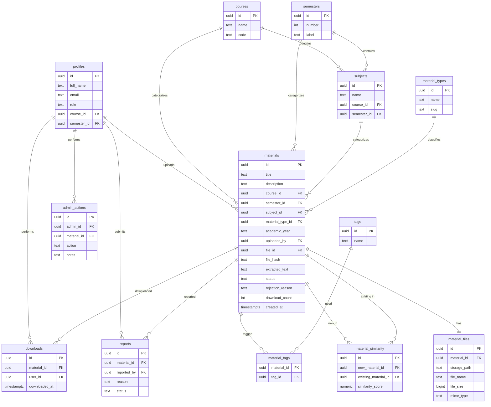
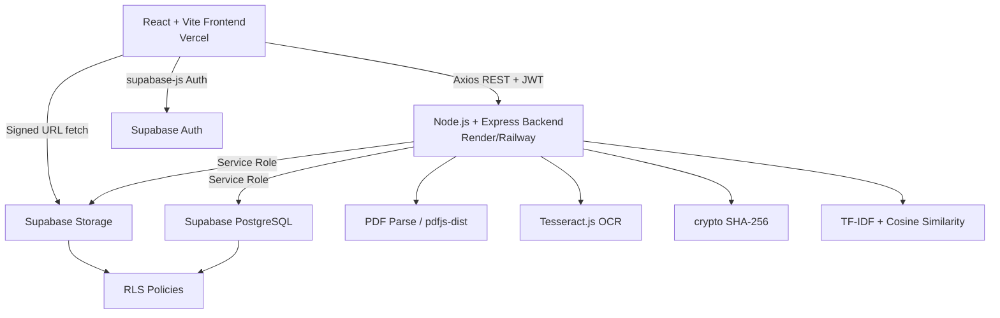
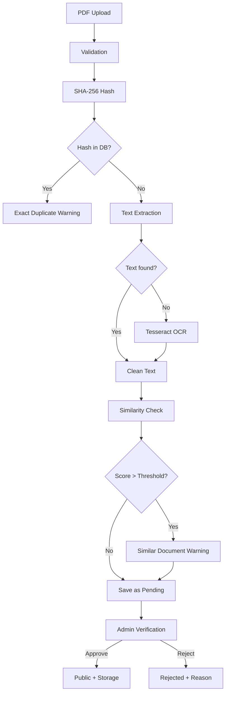
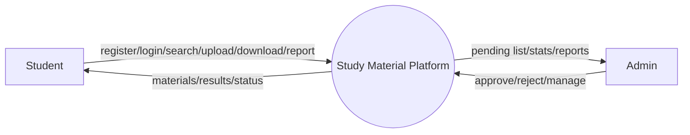
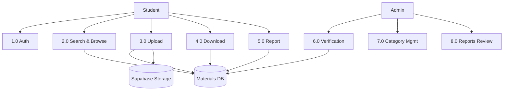
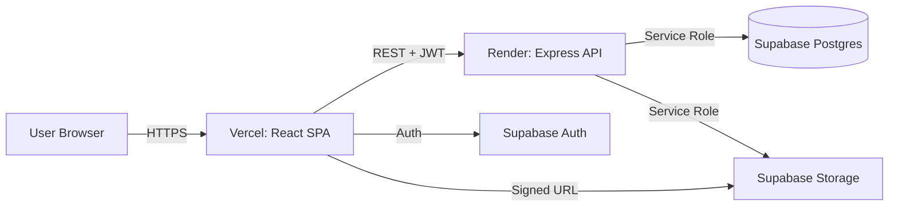

# Product Requirements Document (PRD)
## College Study Material Sharing Platform

**Project Type:** MCA Academic Web Application
**Version:** 1.0
**Document Status:** Implementation-Ready
**Prepared By:** Product & Engineering Team
**Target Stack:** React.js + Vite + Tailwind CSS + Node.js + Express.js + Supabase (PostgreSQL, Auth, Storage)

---

# 1. Executive Summary

The **College Study Material Sharing Platform** is a centralized web application that allows college students to upload, discover, preview, download, and share academic study materials such as notes, assignments, previous-year question papers, lab manuals, question banks, and e-books.

The platform addresses a real and recurring problem in colleges: study materials are scattered across WhatsApp groups, Telegram channels, personal drives, and seniors' folders, making them hard to find, verify, and reuse. The proposed system organizes materials by **course, semester, subject, material type, and academic year**, provides powerful **search and filtering**, and includes a **two-level duplicate detection system**:

1. **Exact duplicate detection** using SHA-256 hashing.
2. **Similar document detection** using PDF text extraction, OCR (Tesseract.js), and text similarity scoring (TF-IDF + Cosine Similarity).

Every uploaded document passes through **admin verification** before becoming publicly visible. Approved materials are stored securely in **Supabase Storage**, indexed in **PostgreSQL**, and protected by **Row Level Security (RLS)**.

The project is intentionally scoped for an **MCA 2nd semester** student. It is realistic, buildable within one academic term, and demonstrates practical software engineering: REST APIs, authentication, RBAC, file handling, hashing, PDF processing, OCR, text similarity, database normalization, and secure deployment.

---

# 2. Problem Statement

College students face several recurring problems when trying to find study materials:

| Problem | Impact |
|---|---|
| Materials scattered across WhatsApp/Telegram groups | Students cannot find old messages/files |
| No proper categorization | Notes are mixed with photos, memes, and unrelated files |
| Duplicate PDFs uploaded repeatedly | Wasted storage and confusion about which version is correct |
| Previous-year papers hard to locate | Students miss important exam preparation resources |
| No verification of content | Wrong subject, incomplete notes, or inappropriate files circulate |
| No central search | Students waste hours asking seniors and classmates |
| No upload history | Contributors cannot track what they uploaded |
| No accountability | Bad content cannot be reported or removed |

**Core problem:** There is no single, organized, searchable, verified, and duplicate-aware platform for college study materials.

---

# 3. Proposed Solution

Build a **web-based academic repository** with the following core capabilities:

1. **Student accounts** via Supabase Auth (email/password).
2. **Structured uploads** with metadata: course, semester, subject, material type, academic year, tags.
3. **File validation** (PDF only, size limit, MIME check, extension check, sanitized filename).
4. **Exact duplicate detection** using SHA-256.
5. **Similar document detection** using text extraction + OCR + TF-IDF/cosine similarity.
6. **Admin verification workflow** — approve/reject with reason.
7. **Search and filtering** across title, subject, course, semester, type, tags, academic year.
8. **PDF preview** using the browser's PDF viewer or PDF.js.
9. **Secure downloads** using Supabase signed URLs.
10. **Reporting system** for inappropriate or incorrect materials.
11. **Admin dashboard** with statistics, category management, and moderation.

Only **approved** materials become searchable and downloadable.

---

# 4. Product Vision

> **Vision:** To become the single trusted academic library for a college — where every student can instantly find verified, well-organized, non-duplicate study material for any subject, semester, or exam, without depending on scattered chat groups.

The platform aims to:
- Replace informal file sharing (WhatsApp, Telegram) with a structured repository.
- Preserve institutional knowledge (notes, papers, manuals) across batches.
- Reduce redundant uploads through duplicate detection.
- Maintain content quality through admin verification.
- Give students a fast, mobile-friendly, searchable experience.

---

# 5. Objectives

| # | Objective | Measurable Outcome |
|---|---|---|
| O1 | Centralize study materials | 100% of uploads go through one platform |
| O2 | Organize by academics | Every material tagged with course/semester/subject/type |
| O3 | Detect exact duplicates | SHA-256 match blocks re-upload |
| O4 | Detect near-duplicates | Similarity score with configurable threshold |
| O5 | Ensure quality | Only admin-approved materials are public |
| O6 | Enable fast discovery | Search results returned in < 2 seconds |
| O7 | Provide secure storage | RLS-enforced Supabase Storage |
| O8 | Support moderation | Report → review → resolve workflow |
| O9 | Track usage | Download counts and admin statistics |
| O10 | Be realistic for MCA | Deliverable in one semester by one student |

---

# 6. Target Users

| User Type | Description | Primary Goal |
|---|---|---|
| **Student / User** | Enrolled college student (MCA, BCA, B.Tech, etc.) | Find and share study materials quickly |
| **Administrator** | Faculty / student coordinator / project admin | Verify, moderate, and organize content |

Secondary (future) users: Alumni, Guest viewers (read-only), Department heads.

---

# 7. User Roles

## 7.1 Student / User

**Capabilities:**
- Register, login, logout
- View dashboard with statistics
- Search and filter materials
- View material details
- Preview PDF in browser
- Download approved materials
- Upload new materials
- Track upload status (Pending / Approved / Rejected)
- View upload history
- Report inappropriate materials
- Manage profile

**Restrictions:**
- Cannot approve/reject materials
- Cannot delete others' materials
- Cannot access admin APIs or admin routes
- Cannot modify approved documents

## 7.2 Administrator

**Capabilities:**
- Login to admin dashboard
- View pending uploads
- Review material metadata, hash, similarity score
- Approve / Reject (with reason) / Request changes
- View and resolve reported materials
- Remove inappropriate materials
- Manage courses, semesters, subjects, material types
- View upload statistics and duplicate detection results
- Configure similarity threshold (optional, admin-only)

**Restrictions:**
- Cannot modify files directly in Storage outside defined policies
- Actions are logged in `admin_actions`

---

# 8. User Stories

### Student
- **US-01:** As a student, I want to register with my college email so I can access materials.
- **US-02:** As a student, I want to search for "DBMS notes" so I can find relevant material quickly.
- **US-03:** As a student, I want to filter by semester and subject so results are precise.
- **US-04:** As a student, I want to preview a PDF before downloading it.
- **US-05:** As a student, I want to upload my notes and track their approval status.
- **US-06:** As a student, I want to be warned if my upload is a duplicate so I don't waste time.
- **US-07:** As a student, I want to report a wrong or inappropriate material.
- **US-08:** As a student, I want to see my upload history and its statuses.

### Admin
- **US-09:** As an admin, I want to review pending uploads with hash and similarity info.
- **US-10:** As an admin, I want to approve or reject materials with a reason.
- **US-11:** As an admin, I want to manage the list of courses, semesters, and subjects.
- **US-12:** As an admin, I want to see reports and take action.
- **US-13:** As an admin, I want to see statistics on uploads, downloads, and duplicates.

---

# 9. Functional Requirements

| ID | Requirement | Description | Acceptance Summary |
|---|---|---|---|
| FR-01 | User Registration | Student registers via email/password | Profile row created, role = student |
| FR-02 | User Login | Login via Supabase Auth | JWT session issued |
| FR-03 | Role Management | Student vs Admin roles | Admin routes blocked for students |
| FR-04 | Material Upload | Upload PDF with metadata | Stored as `pending` |
| FR-05 | File Validation | PDF only, size, MIME, extension | Invalid files rejected |
| FR-06 | SHA-256 Duplicate Detection | Hash file, compare with DB | Exact duplicate flagged |
| FR-07 | PDF Text Extraction | Extract text from text PDFs | Text stored in `extracted_text` |
| FR-08 | OCR Processing | Tesseract.js fallback for scanned PDFs | Text extracted from images |
| FR-09 | Similarity Detection | TF-IDF + cosine similarity | Score computed, warning shown |
| FR-10 | Admin Verification | Approve / Reject with reason | Status updated, audit logged |
| FR-11 | Material Search | Search by title/subject/etc. | Paginated results |
| FR-12 | Material Filtering | Filter by course/sem/type/year | Combined filters work |
| FR-13 | PDF Preview | In-browser preview | Signed URL used |
| FR-14 | Material Download | Download + increment count | Count updated atomically |
| FR-15 | Report Material | Report with reason | Report row created |
| FR-16 | Category Management | CRUD on courses/sems/subjects | Admin-only |
| FR-17 | Upload History | User's uploads with status | Visible on dashboard |
| FR-18 | Download Tracking | Record downloads | `downloads` table populated |
| FR-19 | Admin Dashboard | Moderation + statistics | All sections accessible |
| FR-20 | Statistics | Counts and charts | Real-time from DB |

---

# 10. Non-Functional Requirements

| Category | Requirement | Target |
|---|---|---|
| Performance | Search response | < 2 seconds (p95) |
| Performance | Upload (excluding OCR) | < 10 seconds for ≤ 10 MB |
| Performance | OCR processing | < 60 seconds for ≤ 20 pages |
| Security | Authentication | Supabase Auth (JWT) |
| Security | Authorization | RLS + backend role checks |
| Security | Transport | HTTPS only |
| Availability | Uptime | ≥ 99% (free-tier realistic) |
| Scalability | Users | 500+ students, 5,000+ materials |
| Usability | Mobile support | Fully responsive (320px+) |
| Maintainability | Modular structure | Controllers, services, routes separated |
| Reliability | Upload atomicity | Partial uploads cleaned up |
| Accessibility | WCAG | Level AA basics (labels, contrast, keyboard) |
| Compatibility | Browsers | Chrome, Firefox, Edge, Safari (latest 2) |
| Compatibility | Devices | Desktop, tablet, mobile |

---

# 11. Feature Specifications

## 11.1 Authentication
- Supabase Auth handles registration, login, logout, password reset.
- Frontend uses `supabase-js` with `VITE_SUPABASE_ANON_KEY`.
- Backend verifies JWT via `SUPABASE_JWT_SECRET` or by calling Supabase `auth.getUser(token)`.
- `profiles` table extended with `role` (`student` | `admin`).
- Role stored in `profiles`, not in JWT claims (simpler; verified server-side).
- Password reset via Supabase email link.
- Optional: email verification toggle in Supabase dashboard.

**Communication flow:**
```
React (supabase-js) → Supabase Auth → JWT
React → Axios (Bearer JWT) → Express → verify JWT → Supabase (service role for privileged ops)
```

## 11.2 Student Dashboard
Cards/sections:
- Total available materials
- Recently uploaded (last 10)
- Popular materials (top downloads)
- Materials by subject (bar chart)
- Materials by semester (donut chart)
- My uploads: pending / approved / rejected counts
- Search bar + quick filters
- "Upload Material" CTA

## 11.3 Material Categories
- **Course:** MCA, BCA, B.Tech, Other (admin-manageable)
- **Semester:** 1–8 (admin-manageable)
- **Subject:** configurable, linked to course + semester
- **Material Type:** Notes, Assignment, PYQ Paper, Lab Manual, Question Bank, E-Book, Practical File, Other
- **Academic Year:** 2024-25, 2025-26, etc.

## 11.4 Material Upload
Form fields: title, description, course, semester, subject, material type, academic year, tags, PDF, optional thumbnail.

**Processing pipeline:**
```
Select PDF → Client validation → POST /api/materials/upload
→ Server validation → SHA-256 → DB duplicate check
→ (dup? warn) → PDF text extraction → (no text? OCR)
→ Similarity check → (similar? warn) → Save as pending
→ Admin review → Approve/Reject → Public
```

---

# 12. Duplicate Detection Architecture

## 12.1 Level 1 — Exact Duplicate (SHA-256)

**Why SHA-256?**
- Deterministic: same bytes → same hash.
- Collision-resistant.
- Fast and built into Node's `crypto` module.
- Ideal for identifying byte-identical files regardless of filename.

**Algorithm:**
```js
const crypto = require('crypto');
const hash = crypto.createHash('sha256').update(fileBuffer).digest('hex');
```

**Flow:**
```
File buffer → SHA-256 → hash string
→ SELECT id, title FROM materials WHERE file_hash = $1
→ if found: EXACT DUPLICATE
→ else: continue
```

**Important:** SHA-256 detects only byte-identical files. Renamed files with identical bytes → same hash → detected. Re-saved or content-modified files → different hash → NOT detected here (handled by Level 2).

## 12.2 Level 2 — Similar Document Detection
See Section 15.

## 12.3 Thresholds (Configurable)

| Similarity Score | Category | Action |
|---|---|---|
| 0–50% | Low | Allow upload |
| 50–75% | Moderate | Warn user, allow continue |
| 75%+ | High | Strong warning, show existing doc, admin decides |

> The exact threshold must be **validated during testing** with real documents, not assumed. Start with 75% high, 50% moderate.

---

# 13. PDF Processing Architecture

```
PDF Buffer
  ↓
Try pdf-parse (or pdfjs-dist)
  ↓
Text length > N chars? ── YES → Clean text → store
  ↓ NO
Tesseract.js OCR (page-by-page for large PDFs)
  ↓
Clean text → store
```

**Libraries:**
- `pdf-parse` — simple text extraction (MVP).
- `pdfjs-dist` — alternative for more control.
- `tesseract.js` — OCR engine (WASM, pure JS).
- `pdf-to-img` or `pdfjs-dist` canvas — convert PDF pages to images for OCR.

**Handling large PDFs:**
- Limit pages for OCR (e.g., first 20 pages) in MVP.
- Set processing timeout.
- For MVP: synchronous processing in the upload request.
- Future: move to background queue (BullMQ + Redis).

**OCR limitations:**
- Accuracy depends on scan quality.
- Slower (seconds per page).
- Handwriting is poorly recognized.
- English prioritized in MVP.

---

# 14. OCR Workflow

```
Uploaded PDF
  ↓
pdf-parse → empty/short text?
  ↓ YES (scanned)
Convert pages to images (pdfjs-dist + canvas)
  ↓
For each page:
  Tesseract.js recognize(image) → text
  ↓
Concatenate page texts
  ↓
Clean (lowercase, remove punctuation, stopwords, extra spaces)
  ↓
Store in extracted_text
```

**MVP simplification:** OCR only first N pages (configurable, default 20). If OCR fails, mark document with `extraction_status = 'failed'` and allow admin to review manually.

---

# 15. Similarity Detection Algorithm

**Technique:** TF-IDF + Cosine Similarity.

### Steps
1. **Text Cleaning**
   - Lowercase
   - Remove punctuation, digits (optional), extra whitespace
   - Remove stopwords (English list)
2. **Tokenization** — split into words/tokens.
3. **TF-IDF Vectorization**
   - Build vocabulary across candidate + existing docs.
   - TF = term frequency in doc.
   - IDF = log(N / df).
   - TF-IDF = TF × IDF.
4. **Cosine Similarity**
   ```
   cos(A, B) = (A · B) / (||A|| × ||B||)
   ```
   Score in [0, 1] → convert to percentage.
5. **Comparison Strategy**
   - Compare new doc against a **filtered candidate set** (same subject or same course+semester) to avoid O(n²) full scans.
   - For MVP with a few hundred docs, this is fast.
6. **Threshold Evaluation**

**Example:**
- A: "Data structures are used to organize data efficiently."
- B: "Data structures help organize data in an efficient way."
- SHA-256: different. TF-IDF cosine similarity: high (~0.7–0.85 depending on stopwords).

**Output stored in `material_similarity`:** new_material_id, existing_material_id, score, computed_at.

---

# 16. Database Design

**Tables (13):**
`profiles`, `courses`, `semesters`, `subjects`, `material_types`, `materials`, `material_files`, `tags`, `material_tags`, `material_similarity`, `reports`, `downloads`, `admin_actions`.

### 16.1 profiles
| Column | Type | Notes |
|---|---|---|
| id | UUID PK | = auth.users.id |
| full_name | text | |
| email | text unique | |
| role | text | 'student' / 'admin' |
| course_id | uuid FK | nullable |
| semester_id | uuid FK | nullable |
| avatar_url | text | |
| created_at | timestamptz | default now() |

### 16.2 courses
| id UUID PK | name text unique | code text | created_at |

### 16.3 semesters
| id UUID PK | number int | label text | created_at |

### 16.4 subjects
| id UUID PK | name text | course_id FK | semester_id FK | code text | created_at |
Unique (name, course_id, semester_id).

### 16.5 material_types
| id UUID PK | name text unique | slug text unique |

### 16.6 materials
| Column | Type | Notes |
|---|---|---|
| id | UUID PK | default gen_random_uuid() |
| title | text | required |
| description | text | |
| course_id | UUID FK | |
| semester_id | UUID FK | |
| subject_id | UUID FK | |
| material_type_id | UUID FK | |
| academic_year | text | e.g., '2024-25' |
| uploaded_by | UUID FK profiles.id | |
| file_id | UUID FK material_files.id | |
| file_hash | text | SHA-256 |
| extracted_text | text | |
| extraction_status | text | 'ok' / 'ocr' / 'failed' |
| similarity_score | numeric | max similarity found |
| status | text | 'pending'/'approved'/'rejected'/'removed' |
| rejection_reason | text | |
| download_count | int | default 0 |
| created_at | timestamptz | |
| updated_at | timestamptz | |

**Indexes:** `file_hash`, `subject_id`, `semester_id`, `course_id`, `material_type_id`, `status`, `created_at`, `uploaded_by`. Full-text GIN index on `to_tsvector(title || ' ' || description)`.

### 16.7 material_files
| id UUID PK | material_id FK | storage_path text | file_name text | file_size bigint | mime_type text | page_count int | created_at |

### 16.8 tags
| id UUID PK | name text unique | slug text unique |

### 16.9 material_tags
| material_id FK | tag_id FK | PK(material_id, tag_id) |

### 16.10 material_similarity
| id UUID PK | new_material_id FK | existing_material_id FK | similarity_score numeric | created_at |

### 16.11 reports
| id UUID PK | material_id FK | reported_by FK | reason text | description text | status text ('pending'/'under_review'/'resolved'/'rejected') | created_at | resolved_at |

### 16.12 downloads
| id UUID PK | material_id FK | user_id FK | downloaded_at timestamptz |

### 16.13 admin_actions
| id UUID PK | admin_id FK | material_id FK nullable | action text | notes text | created_at |

**Normalization:** Subjects reference course+semester. Tags are many-to-many. Files stored separately from materials. No duplicated category strings.

---

# 17. ER Diagram



---

# 18. System Architecture



**Processing pipeline:**


---

# 19. Data Flow Diagram

### Level 0 (Context)


### Level 1 (Major Processes)


### Data flows (summary)
- **A. Registration:** Student → Supabase Auth → `profiles` row (role=student).
- **B. Login:** Credentials → Supabase Auth → JWT → stored in memory/session.
- **C. Upload:** File + metadata → backend → validate → hash → duplicate check → extract → similarity → insert `materials` (pending) → upload to Storage.
- **D. Exact Duplicate:** Hash → query `materials.file_hash` → match → warn.
- **E. Similarity:** Extract text → TF-IDF → cosine vs candidates → store in `material_similarity`.
- **F. Admin Approval:** Admin → `PUT /approve` → status='approved' → `admin_actions` logged.
- **G. Search:** Query → filters + FTS → paginated results.
- **H. Download:** Request → verify approved → generate signed URL → increment `download_count` → log `downloads`.
- **I. Report:** Student → `reports` row (pending) → admin resolves.

---

# 20. API Specification

Base URL: `https://api.example.com/api`
Auth: `Authorization: Bearer <supabase_jwt>`

## Auth
**POST /api/auth/register**
```json
Request: { "email": "a@b.com", "password": "Secret123", "full_name": "A B", "course_id": "uuid", "semester_id": "uuid" }
Response 201: { "user": { "id": "uuid", "email": "a@b.com", "role": "student" } }
Errors: 400 invalid, 409 email exists
```

**POST /api/auth/login**
```json
Request: { "email": "a@b.com", "password": "Secret123" }
Response 200: { "access_token": "jwt", "user": { "id": "uuid", "role": "student" } }
Errors: 401 invalid credentials
```

**POST /api/auth/logout** → 204
**GET /api/auth/me** → `{ id, email, role, full_name }`

## Materials
**POST /api/materials/upload** (multipart/form-data)
- Fields: `file`, `title`, `description`, `course_id`, `semester_id`, `subject_id`, `material_type_id`, `academic_year`, `tags`
```json
Response 201: {
  "material_id": "uuid",
  "status": "pending",
  "duplicate": false,
  "similar": [ { "id": "uuid", "title": "...", "score": 0.82 } ]
}
Errors: 400 invalid file, 413 too large, 409 exact duplicate
```

**GET /api/materials?course=&semester=&subject=&type=&year=&q=&page=1&limit=12&sort=recent**
```json
Response 200: { "data": [ { "id","title","subject","semester","type","download_count","created_at" } ], "page":1, "total": 245 }
```

**GET /api/materials/:id** → full detail (approved only for students)
**PUT /api/materials/:id** → owner only, before approval
**DELETE /api/materials/:id** → owner (pending) or admin
**GET /api/materials/:id/download** → `{ "url": "signed_url", "expires_in": 300 }`

## Search
**GET /api/search/materials?q=DBMS&filters...** → same shape as list, relevance-sorted.

## Duplicate Detection
**POST /api/materials/check-duplicate** (multipart: file only)
```json
Response 200: { "exact_match": true, "existing": { "id","title","subject" } }
```

**GET /api/materials/:id/similar**
```json
Response 200: [ { "id","title","similarity_score","subject","semester","created_at" } ]
```

## Admin
**GET /api/admin/materials/pending?page=1** → paginated pending list with hash + similarity
**PUT /api/admin/materials/:id/approve** → `{ status: 'approved' }`
**PUT /api/admin/materials/:id/reject** → body `{ "reason": "Incorrect subject" }`
**GET /api/admin/reports?status=pending**
**PUT /api/admin/reports/:id** → `{ "status": "resolved", "action": "material_removed" }`

## Categories
`GET /api/courses` · `GET /api/semesters` · `GET /api/subjects?course=&semester=` · `GET /api/material-types`
Admin-only: `POST/PUT/DELETE` variants.

## Reports
**POST /api/materials/:id/report**
```json
Request: { "reason": "duplicate", "description": "Same as material X" }
Response 201: { "id": "uuid", "status": "pending" }
```

**Standard error format:**
```json
{ "error": { "code": "DUPLICATE_FILE", "message": "An exact duplicate of this document already exists." } }
```

---

# 21. Frontend Page Specification

| Route | Page | Access |
|---|---|---|
| `/` | Landing | Public |
| `/login` | Login | Public |
| `/register` | Register | Public |
| `/about` | About | Public |
| `/dashboard` | Student Dashboard | Student |
| `/browse` | Browse Materials | Student |
| `/search` | Search Results | Student |
| `/materials/:id` | Material Details | Student |
| `/upload` | Upload Material | Student |
| `/my-uploads` | My Uploads | Student |
| `/my-reports` | My Reports | Student |
| `/profile` | Profile | Student |
| `/admin/login` | Admin Login | Public |
| `/admin` | Admin Dashboard | Admin |
| `/admin/pending` | Pending Materials | Admin |
| `/admin/review/:id` | Material Review | Admin |
| `/admin/approved` | Approved Materials | Admin |
| `/admin/rejected` | Rejected Materials | Admin |
| `/admin/reports` | Reports | Admin |
| `/admin/users` | User Management | Admin |
| `/admin/courses` | Course Mgmt | Admin |
| `/admin/subjects` | Subject Mgmt | Admin |
| `/admin/semesters` | Semester Mgmt | Admin |
| `/admin/stats` | Statistics | Admin |

---

# 22. UI/UX Requirements

**Design principles:** clean, academic, professional, responsive, accessible.

**Navbar:** Logo · Home · Browse · Upload · Dashboard · Profile · Login/Logout

**Material card:**
```
[PDF icon]  Title
Subject · Semester · Type
Uploaded <date> · <n> downloads
[Preview] [Download]
```

**Components:** Cards, tables, modals, toasts, progress bars, loading skeletons, confirmation dialogs, empty states, pagination.

**Upload progress UI:**
```
Uploading...        [====------] 40%
Validating...       ✓
Generating hash...  ✓
Checking duplicate... ✓
Extracting text...  ✓
Checking similarity... ✓
Submitted for verification ✓
```

**Colors:** Primary indigo/blue, accent emerald for approved, amber for pending, red for rejected.

---

# 23. Security Requirements

| Area | Requirement |
|---|---|
| Auth | Supabase Auth; never store plain passwords |
| JWT | Verified server-side on every protected route |
| RLS | Enabled on all Supabase tables |
| RBAC | `role` checked on backend for admin routes |
| Input validation | Joi/Zod on backend; RHF on frontend |
| File validation | MIME + extension + magic bytes + size |
| Filename | Sanitized, UUID-prefixed in storage |
| SQL injection | Parameterized queries via supabase-js |
| XSS | React escapes by default; sanitize descriptions |
| CORS | Whitelist frontend origin only |
| Rate limiting | express-rate-limit on auth + upload |
| Secrets | `.env` only; never committed |
| Service role key | Backend only — **never** in React |
| Signed URLs | Short-lived (5 min) for downloads/preview |
| Admin APIs | JWT + role check + audit log |

**Environment variables:**
```
Frontend: VITE_SUPABASE_URL, VITE_SUPABASE_ANON_KEY, VITE_API_URL
Backend:  SUPABASE_URL, SUPABASE_SERVICE_ROLE_KEY, SUPABASE_JWT_SECRET,
          PORT, MAX_FILE_SIZE_MB, SIMILARITY_THRESHOLD, OCR_PAGE_LIMIT
```

---

# 24. Supabase Architecture

| Service | Usage |
|---|---|
| Auth | Email/password, JWT, password reset |
| PostgreSQL | All 13 tables |
| Storage | `study-materials` bucket |
| RLS | Table + storage policies |
| Edge (optional) | Not required in MVP |

**RLS policy examples:**
```sql
-- Students read approved materials
CREATE POLICY "read approved" ON materials
FOR SELECT USING (status = 'approved' OR uploaded_by = auth.uid());

-- Students insert own uploads
CREATE POLICY "insert own" ON materials
FOR INSERT WITH CHECK (uploaded_by = auth.uid());

-- Students update own pending uploads
CREATE POLICY "update own pending" ON materials
FOR UPDATE USING (uploaded_by = auth.uid() AND status = 'pending');

-- Admin full access (via role check)
CREATE POLICY "admin all" ON materials
FOR ALL USING (
  EXISTS (SELECT 1 FROM profiles WHERE id = auth.uid() AND role = 'admin')
);
```

---

# 25. Storage Architecture

**Bucket:** `study-materials` (private)

**Path convention:**
```
study-materials/
  MCA/
    Semester-1/
      DBMS/
        <uuid>-notes.pdf
  BCA/
    Semester-2/
      ...
```

**Policies:**
| Action | Policy |
|---|---|
| Upload | Authenticated student, path under own upload |
| Read | Signed URL only; approved materials |
| Delete | Owner (pending) or admin |
| Admin | Full access via role |

Students never receive storage credentials — only short-lived **signed URLs** generated by the backend.

---

# 26. Folder Structure

```
college-study-material/
├── frontend/
│   ├── src/
│   │   ├── components/      # Card, Navbar, Modal, Toast, Skeleton
│   │   ├── pages/           # Landing, Login, Dashboard, Upload, Admin...
│   │   ├── layouts/         # StudentLayout, AdminLayout, PublicLayout
│   │   ├── hooks/           # useAuth, useMaterials, useUpload
│   │   ├── services/        # api.js, supabase.js, materials.js
│   │   ├── context/         # AuthContext, ToastContext
│   │   ├── utils/           # formatters, validators
│   │   ├── App.jsx
│   │   └── main.jsx
│   ├── .env.example
│   └── package.json
│
├── backend/
│   ├── src/
│   │   ├── controllers/     # authController, materialController, adminController
│   │   ├── routes/          # auth, materials, admin, categories, reports
│   │   ├── middleware/      # authMiddleware, roleMiddleware, upload, errorHandler, rateLimit
│   │   ├── services/        # hashService, pdfService, ocrService, similarityService, storageService
│   │   ├── utils/           # logger, fileUtils, textCleaner
│   │   ├── validators/      # materialValidator, reportValidator
│   │   └── server.js
│   ├── .env.example
│   └── package.json
│
├── database/
│   ├── schema.sql
│   ├── policies.sql
│   └── seed.sql
│
├── docs/
│   ├── PRD.md
│   ├── SRS.md
│   └── API.md
│
└── README.md
```

---

# 27. Development Roadmap

| Phase | Objective | Key Tasks | Output | Depends On | Testing |
|---|---|---|---|---|---|
| 1 | Project setup | Init React+Vite+Tailwind, Node+Express | Running skeletons | — | Smoke test |
| 2 | Supabase config | Create project, bucket, env vars | Connected services | 1 | Connection test |
| 3 | Authentication | Supabase Auth, profiles, protected routes | Login/register working | 2 | Auth tests |
| 4 | DB schema | Tables, FKs, indexes, RLS | schema.sql applied | 2 | Schema review |
| 5 | Upload | Multer, validation, storage upload | File uploaded to storage | 3,4 | Upload tests |
| 6 | SHA-256 dup | Hash + DB check | Duplicate warning | 5 | Dup tests |
| 7 | PDF extraction | pdf-parse integration | Text stored | 5 | Extraction tests |
| 8 | OCR | Tesseract.js fallback | OCR text stored | 7 | OCR tests |
| 9 | Similarity | TF-IDF + cosine | Score stored | 7,8 | Similarity tests |
| 10 | Admin verification | Approve/reject endpoints + UI | Moderation working | 5 | Workflow tests |
| 11 | Search & filters | Query params, FTS, pagination | Search page | 4 | Search tests |
| 12 | Preview/download | Signed URLs, count increment | Preview + download | 5 | Download tests |
| 13 | Reports | Report form + admin review | Report workflow | 10 | Report tests |
| 14 | UI/UX polish | Skeletons, toasts, responsive | Polished UI | all | UI review |
| 15 | Testing | Unit + integration + E2E | Test report | all | Full suite |
| 16 | Deployment | Vercel + Render + Supabase | Live app | all | Prod smoke |

---

# 28. Testing Strategy

| Type | Scope | Tools |
|---|---|---|
| Unit | Services (hash, similarity, text clean) | Jest |
| Integration | Controllers + DB | Jest + Supertest |
| API | Endpoints, auth, errors | Postman/Newman |
| Database | Constraints, RLS | Supabase SQL tests |
| Auth | Register/login/roles | Jest + manual |
| File upload | Valid/invalid/oversize | Supertest |
| Duplicate | Exact + near | Fixture PDFs |
| Similarity | Threshold tuning | Sample corpus |
| Security | RLS, injection, CORS | Manual + OWASP checklist |
| UI | Components, flows | React Testing Library |
| Responsive | Mobile/tablet/desktop | Chrome DevTools |
| Performance | Search, upload | Lighthouse + k6 (light) |

---

# 29. Test Cases

| ID | Test | Expected |
|---|---|---|
| TC-01 | Student registration | Profile created, role=student |
| TC-02 | Invalid login | 401 error message |
| TC-03 | Valid PDF upload | Material saved as pending |
| TC-04 | Non-PDF upload | 400 rejected |
| TC-05 | Oversized PDF | 413 rejected |
| TC-06 | Exact duplicate PDF | Duplicate warning |
| TC-07 | Renamed duplicate | Same hash → duplicate |
| TC-08 | Modified but similar PDF | Similar warning with score |
| TC-09 | Scanned PDF | OCR triggers |
| TC-10 | Admin approval | Status=approved, public |
| TC-11 | Admin rejection | Status=rejected, reason stored |
| TC-12 | Search "DBMS" | Relevant results |
| TC-13 | Filter by semester | Correct subset |
| TC-14 | PDF preview | Renders in viewer |
| TC-15 | Download | Signed URL + count++ |
| TC-16 | Report submission | Report row created |
| TC-17 | Unauthorized admin access | 403 |
| TC-18 | RLS: student reads others' pending | Denied |
| TC-19 | Storage access without signed URL | Denied |
| TC-20 | Mobile responsiveness | Layout adapts |
| TC-21 | Password reset | Email link works |
| TC-22 | Empty PDF | Rejected with message |
| TC-23 | Password-protected PDF | Handled gracefully |
| TC-24 | Similarity threshold tuning | Adjustable via env |
| TC-25 | Concurrent duplicate uploads | Unique constraint prevents double insert |

---

# 30. Edge Cases

| Case | Handling |
|---|---|
| Same PDF uploaded twice | SHA-256 match → block |
| Same content, renamed file | Same hash → block |
| PDF with changed metadata only | Different hash; similarity check catches |
| PDF with one modified page | Similarity score high → warn |
| Scanned PDF | OCR fallback |
| Empty PDF | Reject with message |
| Password-protected PDF | Reject: "Cannot process protected PDF" |
| Corrupted PDF | Extraction fails → mark `extraction_status='failed'` |
| Very large PDF | Reject above size limit; OCR page cap |
| Image-only PDF | OCR path |
| Mixed text + images | Text extraction first; OCR only if empty |
| OCR failure | Log, mark failed, allow admin review |
| Simultaneous duplicate uploads | Unique index on `file_hash` + transaction |
| Browser closed mid-upload | Temp file cleanup on server |
| Network failure | Axios retry + user toast |
| Storage failure | Rollback DB insert |
| DB failure | 500 with retry guidance |
| Admin rejects | Student sees reason in My Uploads |
| Report on approved material | Admin can remove; status='removed' |

---

# 31. MVP Scope

**Included:**
- Authentication (register/login/logout/reset)
- Student + Admin dashboards
- Material upload with metadata
- PDF-only validation
- SHA-256 exact duplicate detection
- Text extraction (pdf-parse)
- OCR fallback (Tesseract.js)
- TF-IDF + cosine similarity
- Admin verification (approve/reject)
- Search + filters + pagination
- PDF preview + secure download
- Reports + admin review
- Category management
- Supabase DB + Storage + RLS
- Responsive UI

**Excluded from MVP:**
- AI/ML semantic embeddings
- Recommendations
- Ratings/comments
- Mobile app
- Non-PDF formats
- Background job queue
- Multi-language OCR
- Notifications

---

# 32. Future Scope

- Semantic similarity (embeddings + vector DB)
- Recommendation engine
- Bookmarks / favorites
- Ratings & comments
- In-app notifications
- Mobile app (React Native)
- Support for DOCX, PPTX, images
- Better OCR (multi-language, handwriting)
- Background processing (BullMQ + Redis)
- Document versioning
- Institution-specific multi-tenant deployment
- Advanced analytics dashboard
- Plagiarism-style report for uploads

---

# 33. Project Limitations

1. OCR accuracy depends heavily on scan quality.
2. TF-IDF similarity is lexical, not semantic — false positives possible.
3. Large PDFs (50+ pages) slow down synchronous processing.
4. MVP supports only PDF uploads.
5. Manual admin verification is required (no auto-approval).
6. Similarity threshold requires tuning with real data.
7. Supabase free-tier storage/bandwidth limits.
8. English-only OCR in MVP.
9. No real-time collaboration or comments.
10. No offline access.

---

# 34. Success Metrics

| Metric | Target |
|---|---|
| Successful upload rate | ≥ 95% |
| Exact duplicate detection accuracy | 100% (byte-identical) |
| Similar-doc detection precision (tuned) | ≥ 80% |
| Search response time (p95) | < 2 s |
| Avg. upload processing time (≤10 MB, text PDF) | < 10 s |
| Avg. OCR time (10 pages) | < 45 s |
| Download success rate | ≥ 99% |
| Admin approval turnaround | < 24 h |
| Active users (semester) | ≥ 100 |
| Materials uploaded (semester) | ≥ 500 |
| Duplicate uploads prevented | Tracked & reported |

---

# 35. Deployment Architecture

| Component | Platform | Notes |
|---|---|---|
| Frontend | Vercel | Auto-deploy from GitHub `main` |
| Backend | Render / Railway | Node + env vars |
| Database | Supabase PostgreSQL | Managed |
| Storage | Supabase Storage | Private bucket |
| Auth | Supabase Auth | JWT |
| Domain | Custom (optional) | HTTPS enforced |
| CI/CD | GitHub Actions (optional) | Lint + test + deploy |



---

# 36. Risks and Mitigation

| Risk | Impact | Mitigation |
|---|---|---|
| OCR too slow on large PDFs | Poor UX | Page cap, timeout, future queue |
| False positives in similarity | Wrong warnings | Tunable threshold, admin final say |
| Free-tier limits | Downtime | Monitor usage, optimize queries |
| Storage misuse | Cost | Size limits, admin moderation |
| JWT leakage | Security | Short expiry, HTTPS, no localStorage for sensitive data |
| RLS misconfiguration | Data leak | Test policies thoroughly |
| Duplicate race conditions | Data integrity | Unique index + transactions |
| Malicious file upload | Security | MIME + magic byte + size validation |
| Scope creep | Missed deadline | Strict MVP boundary |
| Poor test data | Untuned thresholds | Build a labeled sample corpus |

---

# 37. Acceptance Criteria

**AC-01 — Exact Duplicate**
> Given a student is logged in,
> When the student uploads a PDF that already exists,
> Then the system should calculate the SHA-256 hash and identify the file as an exact duplicate.

**AC-02 — OCR Fallback**
> Given a PDF has no selectable text,
> When the system processes the document,
> Then the system should attempt OCR using Tesseract.js.

**AC-03 — Similar Document Warning**
> Given two documents have high textual similarity,
> When similarity detection completes,
> Then the system should display the similar document and similarity score.

**AC-04 — Admin Approval**
> Given an admin is reviewing a pending material,
> When the admin approves it,
> Then the material should become publicly searchable and downloadable.

**AC-05 — Admin Rejection**
> Given an admin rejects a material,
> When a reason is provided,
> Then the student should see the reason in My Uploads.

**AC-06 — Search**
> Given approved materials exist,
> When a student searches "DBMS",
> Then relevant approved materials should appear within 2 seconds.

**AC-07 — Secure Download**
> Given a material is approved,
> When a student clicks Download,
> Then a signed URL should be generated and the download count incremented.

**AC-08 — RLS**
> Given a student is logged in,
> When they try to access another student's pending material,
> Then access should be denied.

**AC-09 — Report**
> Given a student reports a material,
> When the report is submitted,
> Then it should appear in the admin's report queue.

**AC-10 — Validation**
> Given a non-PDF file,
> When uploaded,
> Then the system should reject it with a clear message.

---

# 38. Final Project Summary

The **College Study Material Sharing Platform** is a realistic, intermediate-level MCA project that solves a genuine campus problem: fragmented, unverified, and duplicated study material. By combining a **React + Vite + Tailwind** frontend, a **Node.js + Express** backend, and **Supabase** (Auth + PostgreSQL + Storage + RLS), the platform delivers:

- Structured, searchable academic content
- A two-tier duplicate detection system (SHA-256 + TF-IDF/cosine similarity)
- OCR fallback for scanned PDFs
- Admin-verified quality control
- Secure storage and signed downloads
- A clean, mobile-friendly UI
- Strong security via JWT + RLS + RBAC

The scope is deliberately bounded for a **single-semester MCA build**, with a clearly separated **MVP** and a realistic **future roadmap**. Every component — from the database schema to the API to the UI — is specified concretely enough to begin implementation immediately, without over-engineering or unnecessary AI/ML complexity.

**This document is the authoritative reference for design, development, testing, and evaluation of the project.**

---

*End of PRD — Version 1.0*